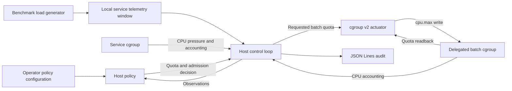

# CoreReserve

**CPU isolation for latency-sensitive services on shared bare-metal Linux servers.**

CoreReserve is a Rust project for operators who run online services alongside interruptible batch workloads. Its goal is to maximize completed batch work per host-hour at a fixed service offered load while keeping service latency and errors within their service-level objectives (SLOs). The current implementation is a single-host prototype that manages batch CPU bandwidth through Linux cgroup v2.

## Problem

Service demand changes over time. During a burst, CPU-intensive batch work can delay runnable service threads, raising tail latency and causing requests to time out. Average CPU utilization can obscure this contention. Dedicated hosts and fixed CPU partitions can protect service capacity, but reserved CPUs may sit idle when demand falls.

## Approach

The host agent evaluates completed service telemetry windows alongside CPU pressure from the service cgroup. Service telemetry supplies p99.9 latency, request counts, and failures. The agent also collects CPU usage and throttling counters for the service and batch cgroups so operators can see how the system responded.

| Policy state | Batch CPU behavior |
| --- | --- |
| Healthy | Use the configured batch CPU ceiling and report that admission is open. |
| Constrained | Reduce quota promptly when CPU pressure, latency, or errors exceed their limits. |
| Recovering | Wait for a stable window, then restore quota in bounded steps. Separate pressure thresholds govern entry and recovery. |
| Unknown | Apply a conservative ceiling and report that admission is closed when telemetry is missing, stale, or insufficient. |

In enforcement mode, the actuator writes `cpu.max` on an explicitly configured, delegated batch cgroup and reads back the result. The service and agent run outside that cgroup. Each live audit entry records the policy revision, input evidence, proposed quota, observed quota, and enforcement result.

## Architecture



| Component | Responsibility |
| --- | --- |
| [CLI](crates/cli) | Host diagnostics, status, policy replay, and the live control loop. |
| [Agent](crates/agent) | Deterministic policy evaluation, typed cgroup access, and quota reconciliation. |
| [Telemetry](crates/telemetry) | Service window schema and validation of the publisher's boot and time namespace. |
| [Benchmark](crates/bench) | Synthetic TCP service, open-loop load generator, and checkpointable CPU workload. |

The live prototype uses a local benchmark publisher and records admission decisions for workloads launched manually in the lab. The planned fleet controller will own job admission, placement, leases, and durable job state. Each host agent will continue to make local CPU protection decisions. Rust eBPF telemetry and topology-aware placement are planned extensions. A custom `sched_ext` backend is optional and depends on a separate feasibility and performance evaluation.

## Getting started

See the [setup and usage guide](docs/getting-started.md) for prerequisites, a smoke test, and a walkthrough of running a latency-sensitive service alongside batch work.

Use Linux with cgroup v2 and install Rust through rustup. The repository pins the Rust toolchain, rustfmt, and Clippy. Live quota enforcement requires a writable delegated batch cgroup.

```sh
cargo build --release --locked
./target/release/corereserve doctor
./target/release/corereserve doctor --format json > lab-manifest.json
```

The manifest records the kernel build, CPU topology, microcode, frequency governors, and cgroup settings. Pass `doctor --cgroup /path/to/batch-cgroup` to check quota access on the intended batch cgroup.

| Task | Guide |
| --- | --- |
| Compare service-only, shared scheduling, and static CPU partitioning at the same offered load | [Contention benchmark](docs/benchmark.md) |
| Evaluate recorded telemetry with `corereserve policy dry-run` | [Policy replay](docs/policy-replay.md) |
| Inspect cgroup status or run the live loop with `corereserve host run --apply` | [Delegated systemd lab](docs/host-lab.md) |

Functional lab tests have verified quota reduction, gradual recovery, stale-data handling, and restart behavior on delegated cgroups. Repeated bare-metal trials with a separate client host are pending.
